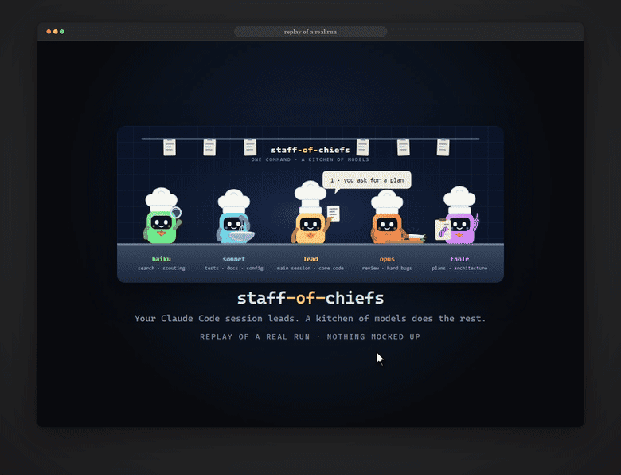
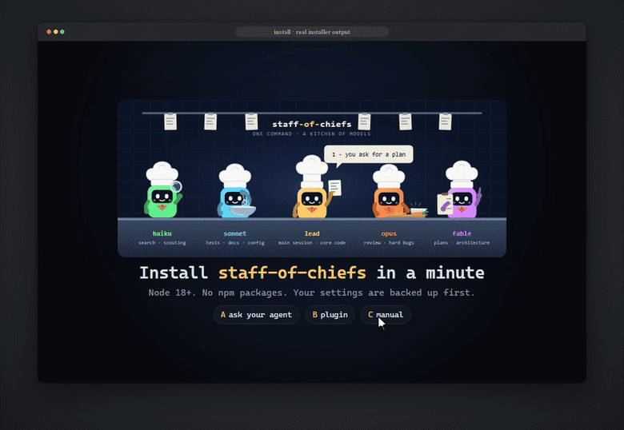
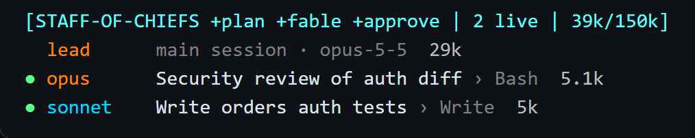
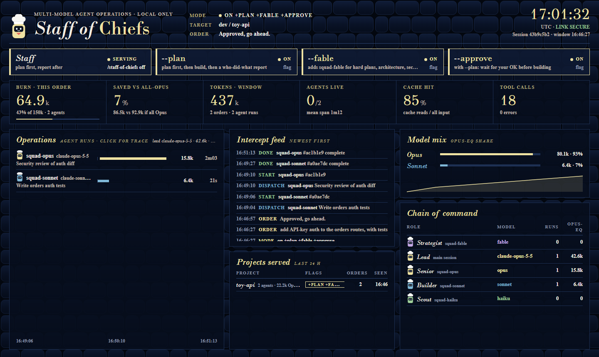

<p align="center"></p>

<h1 align="center">staff-of-chiefs</h1>

<p align="center"><b>One Claude Code command that splits a task across a team of models.</b><br>
Your session leads and writes the core code. Cheaper models take the side work, a second Opus reviews the risky parts,<br>and you watch every agent live in your terminal and on a local dashboard.</p>

<p align="center">
  <a href="https://github.com/Mrwanawad/staff-of-chiefs/actions/workflows/test.yml"></a>
  
  
  
</p>

## TL;DR

- **Type** `/staff-of-chiefs --plan <task>` in Claude Code.
- **The lead** (your session) shows a plan table: each step, its owner, its model and what runs in parallel. Then it writes the core code while Sonnet writes tests and docs, Haiku searches and Opus reviews the risky diff.
- **You see who did what**: live in the status line and on a dashboard at `127.0.0.1:4317`, and in a final report with the test output.
- **Install** by pasting one line into Claude Code (below). Node 18+, no npm packages, and nothing leaves your machine.

<p align="center"></p>

<p align="center"><sub>A replay of a real two-turn run, not a mock-up. Every message, status-line frame and token number comes from the recorded session (see <a href="demo/README.md">demo/README.md</a>).</sub></p>

## Contents

[Quick start](#quick-start) · [The kitchen staff](#the-kitchen-staff) · [What happens when you type the command](#what-happens-when-you-type-the-command) · [Usage](#usage) · [Terminal UI](#terminal-ui) · [Dashboard](#dashboard) · [What it costs](#what-it-costs) · [Install options](#install-options) · [Configuration](#configuration) · [How it works](#how-it-works) · [Troubleshooting](#troubleshooting) · [FAQ](#faq)

## Quick start

<p align="center"></p>

1. **Paste this into Claude Code:**
   ```text
   Install the Claude Code skill from https://github.com/Mrwanawad/staff-of-chiefs. Follow INSTALL_FOR_AGENTS.md.
   ```
   The agent checks Node, shows you a dry run, asks whether you want the status line, installs, and backs up `settings.json` first.
2. **Restart Claude Code**, then run `/staff-of-chiefs status` to check that the hooks are live.
3. **Give it a task:**
   ```text
   /staff-of-chiefs --plan add API-key auth to the orders routes, with tests
   ```

To turn it off: `/staff-of-chiefs off`. To remove it entirely: `node scripts/uninstall.js` (see [Uninstall](#uninstall)).

## The kitchen staff

| | Role | Agent | Model | Work |
|---|---|---|---|---|
|  | **Lead** | main session | your session model (Opus recommended) | plan, file layout, interfaces, **writes the core code**, reviews its own diff |
|  | **Strategist** (only with `--fable`) | `squad-fable` | Fable | hard plans, architecture, threat models, bugs Opus failed to fix |
|  | **Senior** | `squad-opus` | Opus | independent review of risky diffs (auth, payments, data loss, concurrency, security), hard bugs |
|  | **Builder** | `squad-sonnet` | Sonnet | tests, lint and type fixes, configs, docs, boilerplate, mechanical refactors, fixtures |
|  | **Scout** | `squad-haiku` | Haiku | search, call sites, parsing logs/CSV/JSON, renames, commit messages |

The lead only delegates when it pays: the job reads a lot and returns a little, or it is clearly side work. Each agent starts cold and has to be told what the lead already knows, so trivial one-step requests stay solo.

## What happens when you type the command

This is the run in the GIF, step by step: `/staff-of-chiefs --plan --fable --approve add API-key auth to the orders routes, with tests` on a small `node:http` API.

1. **The hook turns the mode on.** It records the flags (`+plan +fable +approve`), starts the dashboard and adds the team protocol to the lead's context. From now on, every prompt you send goes to the team until `/staff-of-chiefs off`.
2. **The lead reads the repo and shows a plan.** Five steps in a table: the lead writes `src/auth.js` and wires the routes, `squad-sonnet` writes the tests, and `squad-opus` reviews the auth diff for security at the same time. It also flags one decision for you (the `x-api-key` header). The lead left Fable out on purpose: the task was small and bounded, so the Opus review covered the security side.
3. **It waits.** With `--approve`, edits are blocked until you reply. The user replied "Approved, go ahead."
4. **The team builds.** The lead wrote the auth module with a constant-time key check that rejects everything if no keys are set. Then Sonnet and Opus ran in parallel. The status line showed `2 live`, each agent's task, its last tool and its tokens.
5. **The review was real.** `squad-opus` started the server and sent real requests: header case, duplicate headers, query strings, trailing slashes, `HEAD`, and `API_KEYS` unset or empty. The lead applied its follow-ups.
6. **The report.** A who-did-what table (step, owner, model), then `# tests 13 # pass 13 # fail 0`, then open items. Nothing was committed, because nobody asked for that.

## Usage

```text
/staff-of-chiefs [--plan] [--fable] [--approve] <task | on | off | status>
```

| Command | What it does |
|---|---|
| `/staff-of-chiefs <task>` | **Autopilot.** Delegates by the rules and says who did what only in the final report. |
| `/staff-of-chiefs --plan <task>` | **Plan first.** Shows the steps, each step's owner and model, and what runs in parallel. Then builds, then reports who did what, the verification output and open items. |
| `/staff-of-chiefs --fable <task>` | Adds `squad-fable` for hard plans, architecture and security review. |
| `/staff-of-chiefs --plan --approve <task>` | Shows the plan, then **waits for your OK** before editing anything. `--approve` implies `--plan`. |
| `/staff-of-chiefs on` / `off` / `status` | Turn the mode on (keeping the flags), turn it off and clear the flags, or print the mode, flags and dashboard link. |

**Flags are sticky.** A command without flags keeps the current ones, and a command with flags replaces them.

```text
/staff-of-chiefs --plan --fable add a /health endpoint with tests to this API
now add a /metrics endpoint too                                  <- still +plan +fable
/staff-of-chiefs --approve migrate the user table to UUID keys   <- now +plan +approve
looks good, go                                                   <- builds the approved plan
/staff-of-chiefs off
```

**How the plan rules are enforced.** Models sometimes skip a plan, or hide it in a progress note you never see. So the hook checks:

- **`--plan` nudge.** If the lead tries to edit a file or dispatch a build agent before a plan has appeared, that first call is denied once, with "show the plan first". After that, calls go through, so it can never deadlock. The dashboard feed logs it as `GATE`.
- **`--approve` gate.** Requests alternate between a planning stage, where edits are denied and the lead must show the plan and end its turn, and a build stage. Your next message is the approval.
- **Never gated:** reading files, and scouting with Haiku or Explore.

**Fable fallback.** If a `squad-fable` dispatch fails with an access, quota, rate-limit or unknown-model error, the ticket goes to `squad-opus`, and you get one line saying so. The failed run shows `✗` in the status line and `NO REPLY` on the dashboard.

## Terminal UI

<p align="center"></p>

| Field | Meaning |
|---|---|
| `+plan +fable +approve` | the active flags |
| `2 live` | agents running right now |
| `39k/150k` | Opus-equivalent tokens this request has used (lead + agents) against the budget. Orange above 75%, red above 100%. |
| `lead · opus-5-5  29k` | your session's model, read from the transcript, and its Opus-eq tokens for this request |
| `●` / `✓` / `✗` | running / done / no reply (it failed, its ticket went to another agent, or it stopped reporting for 90 s at the start or 15 min mid-run) |
| agent name | coloured by tier: fable, opus, sonnet, haiku |
| task | the ticket's description, cut to 46 characters |
| `› Bash` | the agent's last tool call, while it runs |
| last number | that agent's Opus-eq tokens |

It prints nothing of its own while the mode is off. If you already had a status line, yours runs first and these lines come after it. It refreshes every 2 seconds and takes about 50 ms.

## Dashboard

`http://127.0.0.1:4317` opens by itself the first time the mode turns on (`SOC_NO_BROWSER=1` stops that), or click the link that `/staff-of-chiefs status` prints. It binds to `127.0.0.1` only, rejects requests for any other host name, and escapes everything it renders.

<p align="center"></p>

| Panel | Shows |
|---|---|
| Header | mode and flags, target folder, the current request ("order"), clock |
| Flag cards | autopilot or plan, and whether `--plan`, `--fable` and `--approve` are on |
| KPI strip | **Burn**: this request's Opus-eq against the budget. **Saved vs all-Opus**: the same tokens priced as if every agent ran on Opus. **Tokens** in the window, **Agents live**, **Cache hit**, **Tool calls** with error count. |
| Operations | one row per agent run, with a chef avatar in its tier colour that bobs while it's live. Model, task or last tool, a time bar, Opus-eq, duration, and `LIVE` or `NO REPLY`. Click a row for the trace: token ledger, the full ticket, tool usage, recent operations and the agent's last message. |
| Intercept feed | `MODE`, `ORDER`, `DISPATCH`, `START`, `DONE` and `GATE` events, newest first |
| Projects served | one row per session in the last 24 h, with flags, request count and agent tokens |
| Model mix | Opus-eq share per tier, and the cumulative burn curve |
| Chain of command | the roster, with runs and Opus-eq per role |

## What it costs

These numbers are from real runs, so you can see the trade-off.

| Run | What the lead did | Burn (Opus-eq) | Saved vs all-Opus |
|---|---|---|---|
| "add a `/health` endpoint with tests" | delegated only the tests to Sonnet and skipped Opus and Fable ("no risky logic") | not recorded | not recorded |
| "add API-key auth to the orders routes, with tests" (the GIF) | wrote the core code itself; Sonnet wrote 11 tests while Opus ran a live security review | 64.9k (lead 43k, Opus 16k, Sonnet 6.4k) | **7%**, cache hit 85% |

**The lead's own context dominates the bill.** Most of the cost is the lead reading the repo and writing the code, and that would happen without the team too. What the team buys you is mostly not savings. You get a second model reviewing risky code, tests written in parallel, and a record of who did what. Savings grow when the side work is large: big test suites, wide searches, log parsing.

The budget (`SOC_BUDGET`, default 150k Opus-eq per request) is a warning. When a request runs past it, the next prompt tells the lead to delegate less and keep tickets tighter.

## Install options

Everything needs Node 18 or newer. Nothing is downloaded from npm.

### A. Ask your agent (recommended)

Paste the line from [Quick start](#quick-start). The agent follows [INSTALL_FOR_AGENTS.md](INSTALL_FOR_AGENTS.md): it checks Node, runs the installer as a dry run, asks about the status line, installs, and tells you to restart. It never edits `settings.json` by hand. The installer does that, after making a backup.

### B. Plugin

```text
/plugin marketplace add Mrwanawad/staff-of-chiefs
/plugin install staff-of-chiefs@staff-of-chiefs
```

The plugin ships the skill, the four agents and the hooks. With the plugin, the command is also available as `/staff-of-chiefs:staff-of-chiefs`. Plugins can't set a status line, so for the terminal UI, run this once from a clone:

```bash
node scripts/install.js --statusline-only
```

### C. Manual

```bash
git clone https://github.com/Mrwanawad/staff-of-chiefs.git
cd staff-of-chiefs
node scripts/install.js --statusline     # macOS / Linux / WSL / Windows (PowerShell or cmd)
# restart Claude Code, then: /staff-of-chiefs status
```

Installer options:
- `--dry-run`: print the changes and write nothing
- `--statusline`: also wire the status line
- `--statusline-only`: only wire the status line
- `--no-agents`: skip the four agent files

Running it again is safe, because it never adds the same entry twice.

**What it changes:**
- It copies the skill to `<config>/skills/staff-of-chiefs/`, the agents to `<config>/agents/`, and the runtime to `<config>/staff-of-chiefs/runtime/`.
- It adds one hook entry each for SessionStart, UserPromptSubmit, PreToolUse, SubagentStart and SubagentStop, each with a 5 s timeout. The PreToolUse matcher is `Agent|Task|Skill|Edit|Write|MultiEdit|NotebookEdit`.
- With `--statusline`, it sets `statusLine` and saves your old one so it keeps running.
- It keeps your other hooks, and backs up `settings.json` to `settings.json.soc-backup-<timestamp>` first.

`<config>` is `$CLAUDE_CONFIG_DIR`, or `~/.claude`.

### Uninstall

```bash
node scripts/uninstall.js            # add --keep-state to keep the event log
```

It removes only what the installer added and restores your previous status line. If you haven't changed `settings.json` since installing, it's restored byte for byte. For the plugin: `/plugin uninstall staff-of-chiefs@staff-of-chiefs`.

## Configuration

| Setting | Default | What it does |
|---|---|---|
| `SOC_PORT` | `4317` | dashboard port |
| `SOC_BUDGET` | `150000` | Opus-eq tokens per request before the header turns red and the lead is told to delegate less. A warning, not a hard limit. |
| `SOC_NO_BROWSER` | unset | `1` stops the dashboard from opening the browser by itself |

`<config>/staff-of-chiefs/config.json` is optional. The installer creates it when it saves your previous status line:

```json
{
  "weights": { "fable": 2, "opus": 1, "sonnet": 0.5, "haiku": 0.025 },
  "cacheReadFactor": 0.05,
  "previousStatusLine": { "type": "command", "command": "your old status line command" }
}
```

**Opus-eq** is tokens weighted by list price, with Opus = 1. The default weights come from Anthropic's list prices per million input/output tokens: Fable 5.2 $8/$40, Opus 5.5 $4/$20, Sonnet 5.5 $2/$10 and Haiku 5.5 $0.10/$0.50. Cache reads count at 5%. If prices change or you're on a different plan, override the weights.

## How it works

```text
 you type a prompt
        │
        ▼
 ┌──────────────┐  parses /staff-of-chiefs [flags]   ┌──────────────────────────────┐
 │  hook.js     │ ─────────────────────────────────▶ │ state/mode.json              │
 │ (5 events)   │                                    │ {on, plan, fable, approve}   │
 │              │ ── injects protocol every prompt ─▶ main session (Lead)
 │              │ ── plan / approve gates on edits ─▶ allow or deny (PreToolUse)
 │              │ ── logs request/dispatch/start/stop/gate ─▶ state/events.jsonl
 └──────┬───────┘                                    └──────────────────────────────┘
        │ starts (detached)
        ▼
 ┌──────────────┐  reads events + transcripts   ┌──────────────────┐
 │  server.js   │ ────────────────────────────▶ │ 127.0.0.1:4317   │ dashboard.html, /api/state
 │              │ ── every 2 s ───────────────▶ │ state/status.json│ ◀── statusline.js
 └──────────────┘                               └──────────────────┘
```

1. **hook.js** runs on SessionStart, UserPromptSubmit, PreToolUse, SubagentStart and SubagentStop. It always exits 0 and finishes well inside its 5 s timeout.
2. When you type `/staff-of-chiefs ...`, the hook parses the flags and writes `state/mode.json`, with a safe write that refuses symlinks.
3. While the mode is on, every prompt gets the **protocol** in its context. It covers who does what, what a ticket must contain, up to 3 agents in parallel (4 for large independent parts), escalating after 2 failures, the budget, and never inventing results. Agents never commit, push, install or send anything outward unless you asked.
4. On PreToolUse, the hook applies the `--plan` nudge and the `--approve` gate to edit tools and build dispatches.
5. Every request, dispatch, start, stop and gate is appended to `state/events.jsonl`.
6. **server.js** pairs these events into runs and reads each agent's transcript for tokens and tool calls. It serves the dashboard and writes `state/status.json` for **statusline.js**. It exits by itself once the mode is off.

## Requirements

- Claude Code with hooks and subagents, on macOS, Linux, Windows or WSL
- Node 18 or newer (no npm packages)
- Access to the models your flags use. Fable is optional, and a failed Fable dispatch falls back to Opus.

## Troubleshooting

- **`/staff-of-chiefs status` says the hooks aren't running.** Restart Claude Code after installing. Then check that `settings.json` has the `staff-of-chiefs/runtime/hook.js` entries (manual install), or that the plugin is enabled (`/plugin`).
- **Everything happens twice.** Both the plugin and the manual hooks are installed. Remove one: `node scripts/uninstall.js`, or `/plugin uninstall`.
- **`--plan` printed no plan, and the first edit was denied.** That's the nudge working. In headless runs (`claude -p`), models sometimes put the plan in a hidden progress note. The denial tells the lead to print it, and the next call goes through.
- **With `--approve`, nothing gets built.** The gate waits for your next message. Reply with your OK, or with changes to the plan.
- **The dashboard doesn't open.** Open `http://127.0.0.1:4317` yourself. On WSL, install `wslu` for `wslview`; otherwise it falls back to `cmd.exe /c start`. If the port is taken, set `SOC_PORT`.
- **The status line shows only the header.** The dashboard server isn't running, and it's what writes the numbers. Send any prompt while the mode is on and the hook starts it.
- **An agent shows `✗` / `NO REPLY`.** It failed, its ticket was re-sent to another agent (the Fable fallback), or it stopped reporting. The lead's report says what happened to that step.
- **The squad agents aren't listed.** The protocol tells the lead to use `general-purpose` with the `model` override instead.

## FAQ

**Does it cost more?** Sometimes a bit less, sometimes about the same. See [What it costs](#what-it-costs). Trivial requests stay solo, and the budget line tells you when a request ran hot.

**Where does my data go?** Nowhere. The event log, status file and mode file live in `<config>/staff-of-chiefs/state` on your machine. The dashboard binds to `127.0.0.1` only. staff-of-chiefs itself sends nothing anywhere.

**Can it work without `--plan`?** Yes. Autopilot is the default.

**How do I remove it completely?** `node scripts/uninstall.js` (or `/plugin uninstall ...`). Add `--keep-state` if you want to keep the event log.

**Other tools (Cursor and others)?** Not in v0.1.

**Are the chef bots official Claude characters?** No. They're original drawings for this project (`assets/make-art.js` draws them as plain SVG). staff-of-chiefs is a community project and isn't affiliated with Anthropic.

## Future work

- A toggle for MCP connectors that a plan needs
- Enforcing the budget (today it is only a warning)
- Agents and adapters for other coding tools

## Contributing

Issues and PRs are welcome. See [CONTRIBUTING.md](CONTRIBUTING.md). In short:
- `node --test` runs everything, with no dependencies, on any OS.
- Hooks must always exit 0.
- The installer and uninstaller stay exact mirrors.

Report security issues privately, as described in [SECURITY.md](SECURITY.md). Release notes are in [CHANGELOG.md](CHANGELOG.md).

## License

[MIT](LICENSE)
